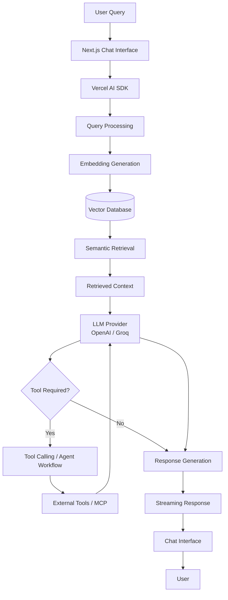

# AI SDK RAG Chatbot

An AI-powered conversational application built with **Next.js 16, React 19, TypeScript, and Vercel AI SDK 7**, exploring modern AI application development through Retrieval-Augmented Generation (RAG), semantic search, LLM integrations, tool calling, and agentic workflows.

The application combines a modern conversational interface with AI capabilities to enable context-aware interactions and extend LLM functionality through tools and external integrations.

## Key Features

- **Retrieval-Augmented Generation (RAG):** Context-aware responses using retrieved information from a knowledge base.
- **AI-Powered Conversations:** LLM integration using OpenAI and Groq providers.
- **Streaming Responses:** Real-time response generation using Vercel AI SDK.
- **Tool Calling:** Enables language models to invoke application-defined tools and functions.
- **AI Agents:** Supports agentic workflows and multi-step AI interactions.
- **Embeddings & Semantic Search:** Processes text embeddings for similarity-based information retrieval.
- **Document Processing:** PDF parsing and text splitting for document-based knowledge retrieval.
- **MCP Integration:** Extensible architecture for connecting AI applications with external tools and capabilities.
- **Authentication:** User authentication and management using Clerk.
- **Modern UI:** Responsive conversational interface built with Next.js, React, Tailwind CSS and shadcn components.

## Architecture

The following diagram illustrates the conceptual flow of the RAG application, from user interaction to contextual response generation.



_Note: This is a conceptual architecture. Adapt the database, embedding, and MCP connections to the actual execution flow implemented in the codebase._

## Tech Stack

| Category            | Technologies                             |
| ------------------- | ---------------------------------------- |
| Framework           | Next.js 16, React 19                     |
| Language            | TypeScript                               |
| AI Framework        | Vercel AI SDK 7                          |
| LLM Providers       | OpenAI, Groq                             |
| AI Concepts         | RAG, Embeddings, Tool Calling, AI Agents |
| Document Processing | PDF Parse, LangChain Text Splitters      |
| Database            | Neon Serverless PostgreSQL               |
| ORM                 | Drizzle ORM                              |
| Authentication      | Clerk                                    |
| UI & Styling        | Tailwind CSS 4, shadcn, Base UI          |
| Visualization       | XYFlow / React Flow                      |
| Validation          | Zod                                      |

## How RAG Works

The application follows a Retrieval-Augmented Generation approach:

1. **Document Ingestion:** Source documents are uploaded and processed.
2. **Text Extraction:** Document content is extracted and split into smaller chunks.
3. **Embedding Generation:** Text chunks are converted into vector embeddings.
4. **Vector Storage:** Embeddings and associated content are stored for retrieval.
5. **Semantic Retrieval:** User queries are matched against relevant stored embeddings.
6. **Context Augmentation:** Retrieved information is included in the LLM context.
7. **Response Generation:** The language model generates context-aware responses.
8. **Streaming:** Responses are streamed back to the client through the AI SDK.

## Getting Started

### Prerequisites

- Node.js (compatible with your Next.js version)
- npm
- OpenAI API key and/or Groq API key
- Configured database connection

### 1. Clone the repository

```bash
git clone https://github.com/coder-pixel/aisdk-rag-chatbot.git

cd aisdk-rag-chatbot
```

### 2. Install dependencies

```bash
npm install
```

### 3. Configure environment variables

Create a `.env.local` file in the root directory.

Add the environment variables required by your implementation.

```env
# AI Providers
OPENAI_API_KEY=your_openai_api_key
GROQ_API_KEY=your_groq_api_key

# Database
DATABASE_URL=your_neon_database_url

# Authentication
NEXT_PUBLIC_CLERK_PUBLISHABLE_KEY=your_clerk_publishable_key
CLERK_SECRET_KEY=your_clerk_secret_key
```

_Important: These are representative variable names. Check your source code for the exact environment variable names and add any additional credentials required by your integrations._

### 4. Run the development server

```bash
npm run dev
```

Open [http://localhost:3000](http://localhost:3000) in your browser.

### 5. Build for production

```bash
npm run build

npm run start
```

## Available Scripts

| Command         | Description                   |
| --------------- | ----------------------------- |
| `npm run dev`   | Starts the development server |
| `npm run build` | Creates a production build    |
| `npm run start` | Starts the production server  |
| `npm run lint`  | Runs ESLint                   |

## Key Learning Areas

This project explores several concepts in modern AI application engineering:

- Building AI-powered applications using Vercel AI SDK.
- Implementing RAG pipelines and semantic retrieval.
- Working with embeddings and vector-based search.
- Integrating multiple LLM providers.
- Implementing streaming conversational interfaces.
- Connecting LLMs with external tools using tool calling.
- Building agentic workflows and multi-step AI interactions.
- Processing documents for knowledge-based question answering.
- Integrating authentication and database infrastructure into AI applications.

## Future Improvements

- Improve retrieval quality using advanced chunking and reranking strategies.
- Introduce RAG evaluation and response-quality measurement.
- Add observability and tracing for AI workflows.
- Expand external tool integrations and MCP capabilities.
- Improve error handling, caching and production scalability.

## Author

**Sauvik Kumar Goel**

- GitHub: [coder-pixel](https://github.com/coder-pixel)
- LinkedIn: [Sauvik Goel](https://www.linkedin.com/in/sauvik-goel-ba8847178/)
- Portfolio: [sauvik-portfolio.vercel.app](https://sauvik-portfolio.vercel.app/projects)

---

_Built as a hands-on exploration of modern AI application development, RAG systems, and agentic workflows._
